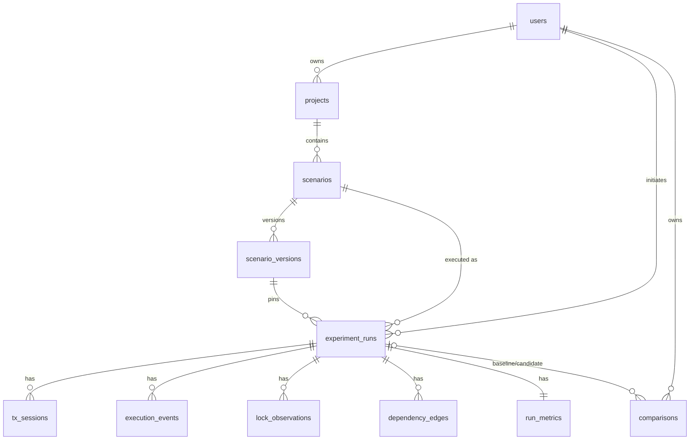

# LockLens — Transaction Intelligence & Concurrency Experiment Platform

LockLens makes PostgreSQL concurrency anomalies **reproducible, observable, understandable and measurable**. It is a real transaction laboratory: experiments execute as genuine concurrent PostgreSQL sessions coordinated by deterministic application-level barriers — nothing is simulated.

## Signature features

### 1. Deterministic Schedule Studio
Define multi-transaction scenarios as ordered steps (`sql`, `checkpoint`, `commit`, `rollback`). Named checkpoints are real application-level barriers that coordinate independent PostgreSQL sessions (one connection + thread per transaction, T1–T4). Supports pause/resume, cancellation (including `pg_cancel_backend` hard-stop), per-session `statement_timeout`/`lock_timeout`, a hard run timeout, and value flow between steps via `{{placeholder}}` + `save_as` (read-modify-write workloads).

### 2. Evidence-Backed Anomaly Investigator
Every step emits an ordered event (SQL, result rows, duration, SQLSTATE on error). A lock poller samples `pg_locks`/`pg_blocking_pids` during execution. Detectors (documented scope, tested positive & negative cases):

| Detector | Evidence | Status semantics |
|---|---|---|
| `deadlock_observed` | SQLSTATE 40P01 from a real session | confirmed |
| `serialization_failure_observed` | SQLSTATE 40001 | confirmed |
| `invariant_violation` | declared invariant SQL re-evaluated after commit | confirmed |
| `non_repeatable_read` | same SELECT text, same transaction, changed rows, no intervening write | confirmed under READ COMMITTED |
| `non_serializable_outcome` | final state matches **no** counterfactual serial replay (all permutations re-executed on fresh seed) | confirmed / inconclusive |

Anything outside this scope is reported as inconclusive or not reported — no universal-detection claims.

### 3. Counterfactual Repair Lab
Compare a baseline run with a controlled candidate: isolation-level override, mechanical `SELECT … FOR UPDATE` rewrite, or consistent lock ordering (UPDATE steps sorted by row id). Both sides execute as fresh deterministic runs; the verdict compares correctness (invariant violations, confirmed anomalies) against measured wall time, lock-wait time, aborts — and always displays its limitations (single run, indicative not proof).

## Architecture

```
┌──────────────┐   HTTPS    ┌─────────────────────────────────────────┐
│ React + TS   │ ─────────► │ FastAPI                                  │
│ Vite/Tailwind│            │  ├─ routers: auth/scenarios/runs/…      │
│ React Flow   │            │  ├─ RunManager ──► ScheduleEngine        │
│ Recharts     │            │  │     (thread + psycopg conn per Tx)    │
└──────────────┘            │  │     barriers/pause/cancel/timeouts   │
                            │  └─ analyzers (evidence → findings)     │
                            └───────┬──────────────────┬──────────────┘
                          SQLAlchemy│                  │ psycopg (experiments ONLY)
                            ┌───────▼──────┐   ┌───────▼──────────────┐
                            │ locklens     │   │ locklens_lab         │
                            │ (metadata:   │   │ (schema lab; reset   │
                            │ users, runs, │   │  & seeded per run;   │
                            │ events, …)   │   │  least-priv. role)   │
                            └──────────────┘   └──────────────────────┘
```

**Hard boundary:** experiment SQL only ever connects to `LAB_DATABASE_URL`. The metadata API uses SQLAlchemy with parameterized queries. Step SQL is validated (single statement, DML/SELECT only, deny-list for dangerous functions), bounded by statement/lock timeouts and row caps.

## Data model (ER)



## Quick start (Docker)

```bash
cp .env.example .env       # set JWT_SECRET (openssl rand -hex 32)
docker compose up --build
# frontend http://localhost:3000  ·  API http://localhost:8000/docs
```

## Local development

```bash
# PostgreSQL 16+ running; create databases locklens + locklens_lab
cd backend
pip install -r requirements-dev.txt
export DATABASE_URL=postgresql+psycopg://user:pw@localhost:5432/locklens
export LAB_DATABASE_URL=postgresql://user:pw@localhost:5432/locklens_lab
export JWT_SECRET=$(openssl rand -hex 32)
alembic upgrade head                 # migrations (app also create_all()s on dev startup)
uvicorn app.main:app --reload        # http://localhost:8000

cd ../frontend
npm install && npm run dev           # http://localhost:5173 (proxies /api)
```

## Tests

```bash
cd backend
python -m pytest tests/              # unit + real-PostgreSQL integration
cd frontend
npm run build                        # type-check + production build
npx playwright test                  # critical e2e (needs backend :8000 + preview :4173)
```

**Verified in the development sandbox (PostgreSQL 17.11):** 33 backend tests + 7 real-concurrency integration tests pass — including: lost update produces an impossible final state (confirmed vs both serial replays); write skew violates the on-call invariant under REPEATABLE READ; SERIALIZABLE/SSI aborts the same schedule with 40001; deadlock detector aborts one victim with 40P01 and the wait-for cycle is captured from `pg_locks`; lock-timeout bounds a blocked step (55P03); mid-run cancellation terminates blocked backends. Playwright e2e (register → run → evidence → export) passes on desktop and mobile viewports.

## API summary

| Method | Path | Purpose |
|---|---|---|
| POST | `/api/auth/register` `/api/auth/login` | JWT auth |
| GET/POST | `/api/projects` | project ownership |
| GET/POST | `/api/scenarios` · `/{id}` · `/{id}/versions` · `/{id}/clone` | scenario CRUD, immutable versions |
| POST | `/api/runs` | launch run from a scenario version |
| GET | `/api/runs` · `/{id}` | history, live detail (events/sessions/metrics) |
| POST | `/api/runs/{id}/control` | pause / resume / cancel |
| POST/GET | `/api/comparisons` | repair-lab comparisons |
| GET | `/api/export/runs/{id}.{json,csv,html}` | exportable bundles & reports |
| GET | `/api/lab/info` `/api/lab/schema` · POST `/api/lab/explain` | lab introspection |
| GET | `/api/health` `/api/ready` | health/readiness |

All list endpoints paginate (`page`, `page_size` ≤ 100). Errors are consistent `{detail, code}` JSON. Interactive OpenAPI docs at `/docs`.

## Scenario definition format

```jsonc
{
  "seed_sql": ["CREATE TABLE lab.accounts (...)", "INSERT INTO lab.accounts ..."],
  "transactions": [{
    "name": "T1", "isolation": "READ COMMITTED",
    "steps": [
      {"kind": "sql", "sql": "SELECT balance FROM lab.accounts WHERE id = 1", "save_as": "bal"},
      {"kind": "checkpoint", "name": "both_read"},
      {"kind": "sql", "sql": "UPDATE lab.accounts SET balance = {{bal}} - 20 WHERE id = 1"},
      {"kind": "commit"}
    ]
  }],
  "invariants": [{"name": "...", "sql": "SELECT balance FROM lab.accounts WHERE id = 1", "expect": "60"}],
  "final_state_sql": "SELECT id, balance FROM lab.accounts ORDER BY id"
}
```

A `commit` step mid-sequence commits and immediately begins the next transaction in the same session — this is how the non-repeatable-read scenario orders T2's commit before T1's re-read.

## Security notes

- Two databases with separate credentials; the lab role has rights only on schema `lab` (see `db/init/01_lab.sql`).
- Step SQL guard: exactly one statement, SELECT/INSERT/UPDATE/DELETE only, deny-list (`pg_terminate_backend`, `COPY`, `dblink`, role/grant changes, …). Guard is defense-in-depth, **not** a general sandbox — the database boundary is the primary control.
- Bounded execution: `statement_timeout`, `lock_timeout`, `idle_in_transaction_session_timeout`, hard run timeout, row caps, session cancellation via `pg_cancel_backend`.
- PBKDF2-HMAC-SHA256 password hashing (210k iterations), JWT (HS256) auth, server-side ownership checks on every object; cross-user access returns 404.
- No secrets in the repo; `JWT_SECRET` is mandatory via env in production.

## Deployment (Render)

1. Create a managed PostgreSQL instance; create databases `locklens` and `locklens_lab` plus the lab role (adapt `db/init/01_lab.sql`).
2. Deploy `backend/` as a Web Service (Docker). Env: `DATABASE_URL`, `LAB_DATABASE_URL`, `JWT_SECRET`.
3. Deploy `frontend/` as a Static Site (`npm run build`, publish `dist/`) with an `/api/*` rewrite to the backend, or use the provided Dockerfile+nginx.

## Known limitations

- **Single-process run coordination** — the RunManager registry is in-memory; run control (pause/resume/cancel) works only against the API process that launched the run. Scale-out requires an external coordinator (documented extension point).
- Lock-wait timing is sampled (poll interval, default 50 ms) — approximate by design.
- Declared dependency edges are table-level (parsed from step SQL), not row-level.
- Counterfactual serial replays assume steps are deterministic given their `save_as` inputs.
- Comparisons run each side once; treat verdicts as indicative, never proof.
- The SQL guard intentionally allows `pg_sleep` (needed to hold locks in schedules) — bounded by `statement_timeout`.
